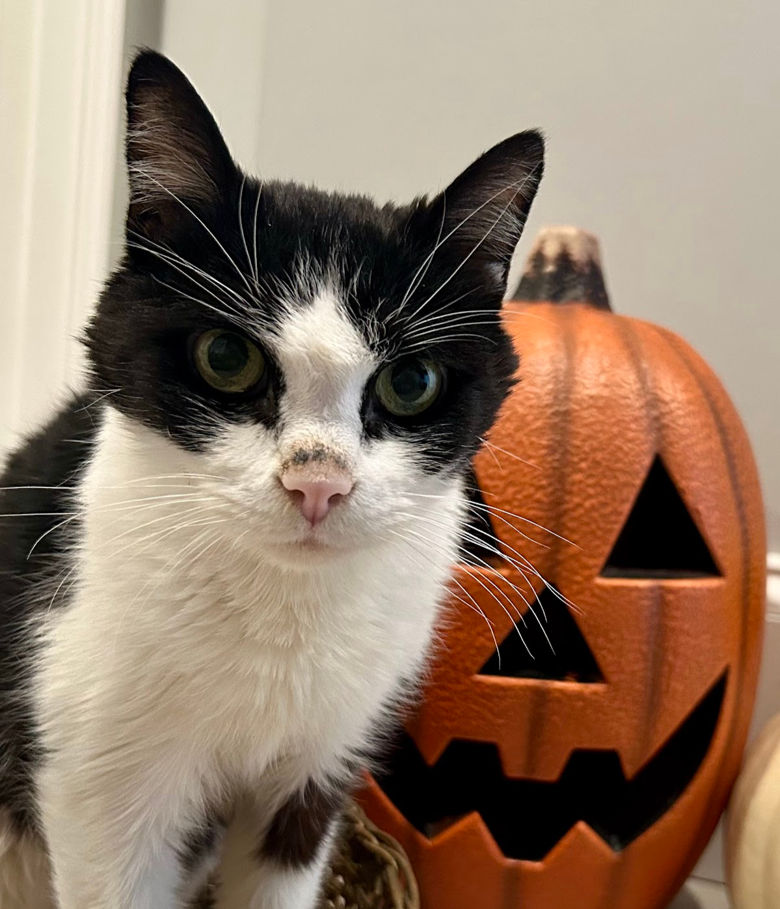
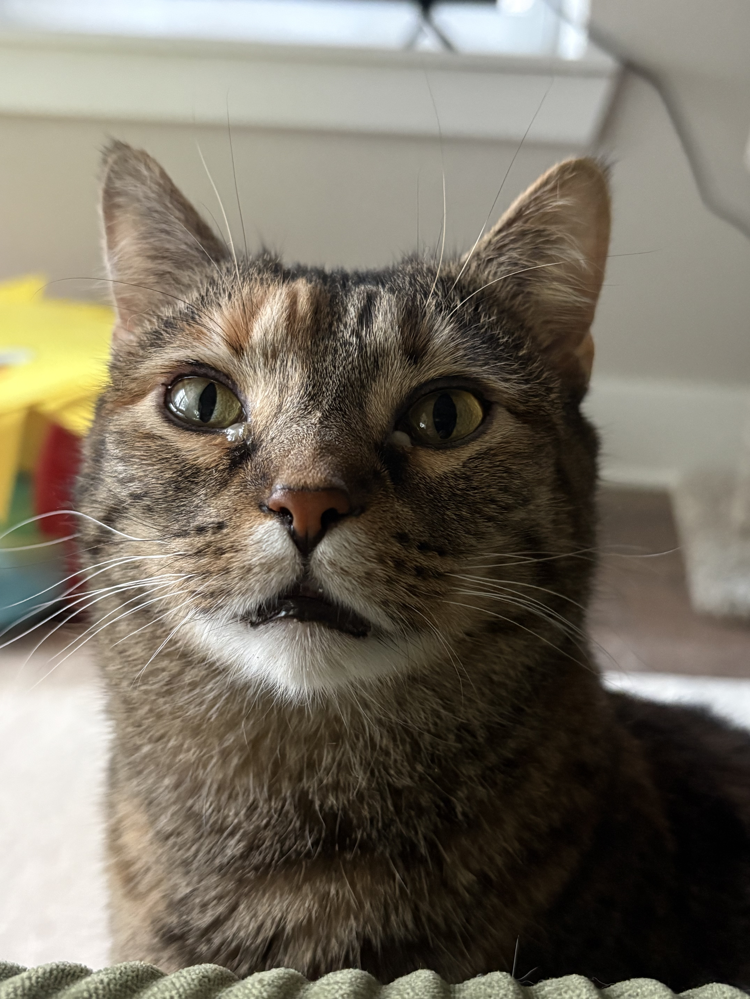
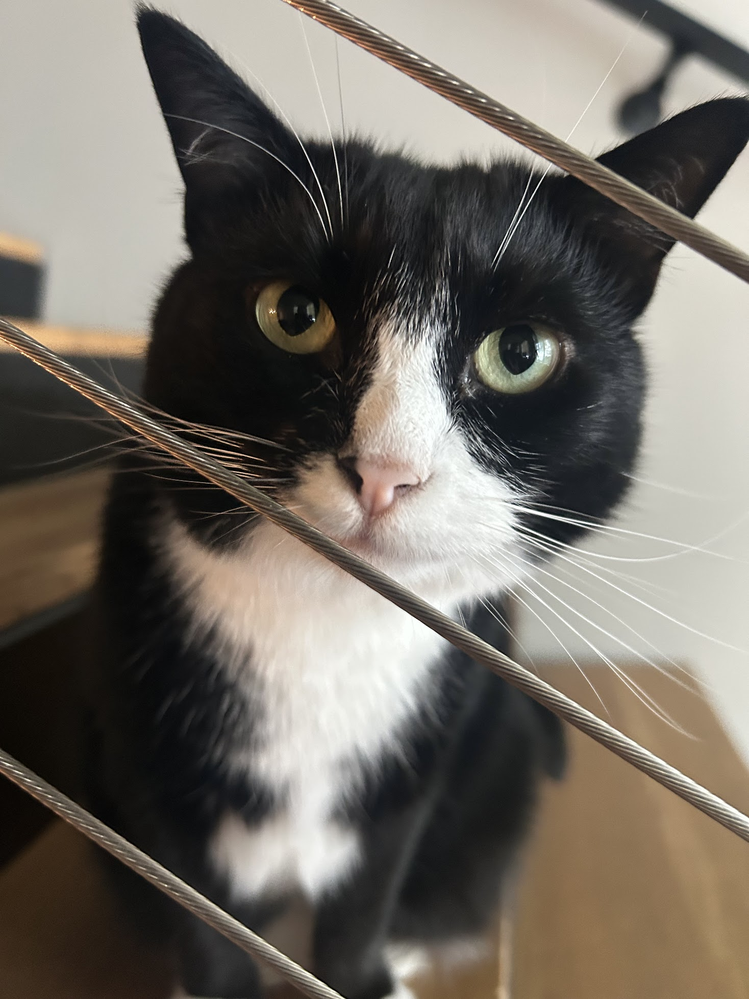
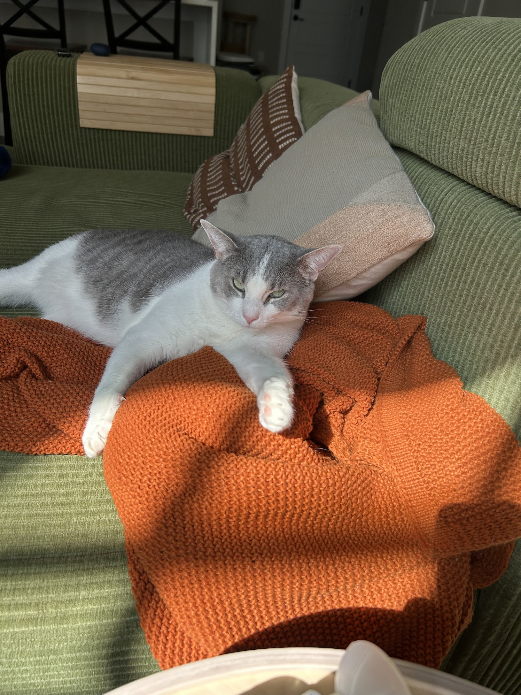
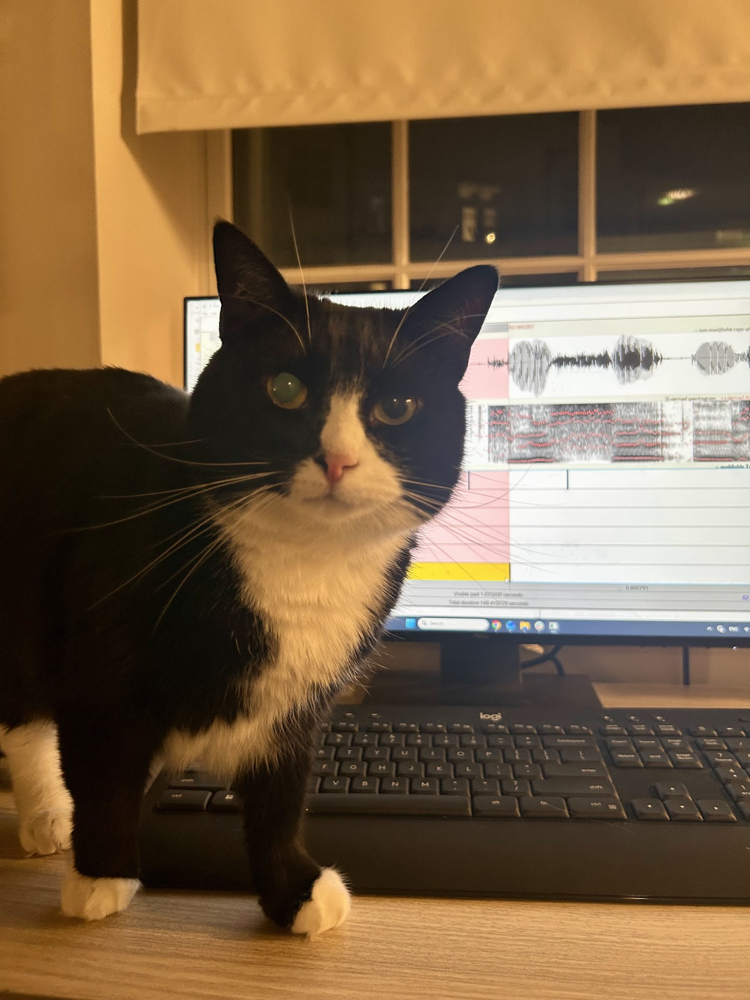

Mr. Wobbles is our family covid cat. We think he's about 16 years old. He has cerebellar hypoplasia, which makes him a little wobbly. He's a very quirky guy.

In Nashville, I live with Kenny and Dolly and their foster brother Earl, who is up for adoption!

    
 
        
  

        
 Mr. Wobbles is our scraggly little weirdo. 

    

     
 
        
  

        
 Dolly likes treats and attention. 

    

    

    

    
 
        
  

        
 Kenny likes being judgemental. 

    

    
 
        
  

        
 Earl likes to get comfy wherever he is. 

    

    

 
    
  

    
 Kenny has an interest in sociophonetics. 

    <button id="random-cat-btn" class="random-cat-btn" type="button"> Press for cat photo </button>

 
 
