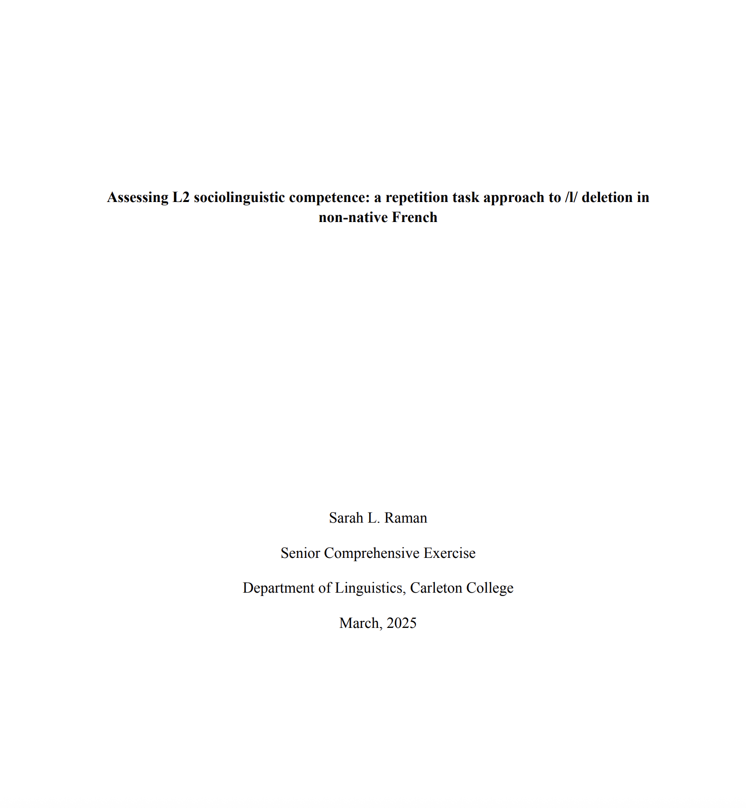

 Here is some of my past academic work. I would be more than happy to correspond
over email about any of the projects linked here. 

 Senior Thesis in Linguistics 

    

        
 <a href="/assets/docs/comps_submission.pdf" target = "_blank"> Assessing L2 sociolinguistic competence: a repetition task approach to /l/ deletion in non-native French </a> 

        
 Linguistics Thesis at Carleton College. 

        
 My senior thesis used a novel repetition task to assess advanced French learners' usage of variable /l/ deletion. I was particularly interested in the question: does a higher variable usage rate correlate with adherence to L1-like linguistic factor weights conditioning deletion, or are those two aspects of sociolinguistic competence acquired separately?  
        

        
 This project was awarded distinction by the Carleton College Department of Linguistics. 
        

    

    
  
    

  
